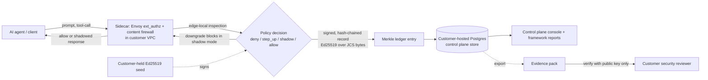

# Varman Data Flow and Trust Boundaries

Audience: a customer security reviewer deciding whether Varman is safe to place in-path with their AI agents.

This document describes exactly what data Varman sees, where that data lives, and what never leaves the customer environment. It is written to be checked against the code, not taken on faith.

## The three scary questions, answered first

1. **Does the vendor see our prompts?** No. Content inspection is edge-local, inside the sidecar that runs in your environment. Raw prompts never leave your VPC. The vendor has no data path to them.
2. **Does the vendor hold our signing keys?** No. The Ed25519 signing seed is customer-held configuration. It stays in your environment. The vendor never receives it, which is also why evidence packs verify with the public key alone.
3. **Can Varman break our AI?** No, within the pilot design. Shadow mode records and downgrades any would-be block, so it cannot block traffic. When the control plane is unreachable, the data plane fails closed to the last-good configuration rather than losing governance, and in shadow that last-good policy still does not block. A scoped kill-switch returns enforcement to shadow in one step.

## The two planes

- **Control plane** (`server/`): the Kyte web server, Postgres-backed, with a Datastar hypermedia console. It handles policy authoring, decisions, approvals, evidence, compliance reporting, content-rules, and OPA bundle signing. It runs in the customer VPC.
- **Data plane** (`sidecar/`): an Envoy `ext_authz` handler plus the content firewall. It sits next to the governed endpoint, enforces at the edge, and fails closed to last-good config if the control plane is unreachable.

Both planes run inside the customer environment. There is no vendor-hosted component in the data path.

## What data Varman sees

- At the edge (sidecar): the prompts and tool-calls flowing to the governed endpoint, inspected locally by the content firewall.
- In the control plane: policy definitions, decision records, violation records, approvals, and compliance mappings. Decision and violation records are the signed, hash-chained outputs of enforcement, not raw traffic dumps.

## Where data lives

- Raw prompts and tool-calls: inspected in memory at the edge, in the customer VPC. They are not shipped to the vendor.
- Decision and violation records: stored in the customer-hosted Postgres, as signed, hash-chained entries in an RFC 6962 Merkle ledger.
- Signing keys: customer-held configuration in the customer environment.

## What never leaves the customer environment

- Raw prompts and tool-call content (inspected edge-local only).
- The Ed25519 signing seed (customer-held config).

## Trust core

Every decision and every violation becomes a signed, hash-chained record:

- **Ed25519** signatures over **JCS** canonical bytes (so the signed form is deterministic and re-derivable).
- **SHA-256** hashing.
- An **RFC 6962 Merkle ledger** supporting both inclusion proofs (this record is in the log) and consistency proofs (the log was only appended to, never rewritten).
- The content firewall additionally hash-chains violation records with a `prevSig` chain.

Because records are signed over canonical bytes with a customer-held key, an **evidence pack verifies independently using the public key alone**. The reviewer does not need to trust the Varman store, the vendor, or even a running Varman instance to confirm that the records are authentic and the log was not tampered with.

## Textual data flow

Reading the flow:

1. The agent sends a prompt or tool-call toward the governed endpoint.
2. The sidecar inspects it locally (edge-local, no egress of raw content) and asks the policy for a decision.
3. The policy returns one of deny, step_up, shadow, or allow. Precedence is deny > step_up > shadow > allow, and the in-process manifest engine fails closed to deny on error. In shadow mode, any deny or step_up is downgraded so traffic is not blocked.
4. The decision is signed with the customer-held key over JCS canonical bytes and appended as a Merkle ledger entry.
5. Records persist in the customer-hosted Postgres and surface in the control plane console and framework reports.
6. An evidence pack can be exported and verified independently by the reviewer with the public key alone.

## Boundary summary

| Boundary | Inside customer VPC | Crosses to vendor |
|----------|---------------------|-------------------|
| Raw prompts / tool-calls | Yes (edge-local) | Never |
| Signing seed | Yes (customer config) | Never |
| Decision / violation records | Yes (customer Postgres) | Never (vendor does not host) |
| Public key for verification | Yes | Shareable by the customer at their discretion |
