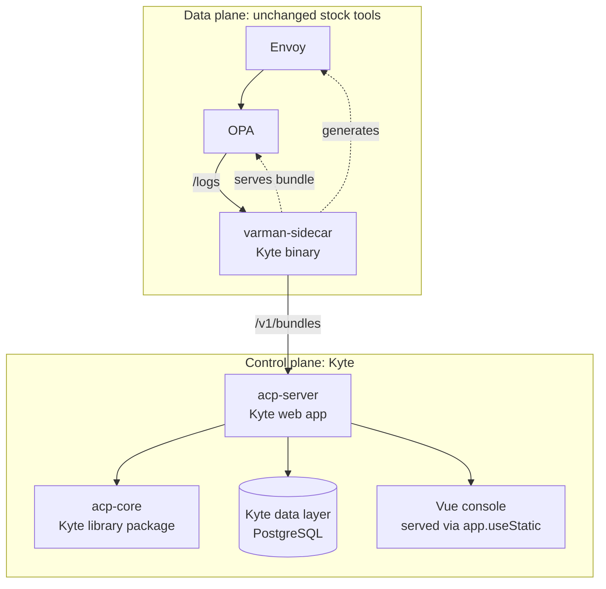

# Varman: Rust to Kyte migration design

This document is a design and feasibility plan for porting Varman (internally the Agent Control Plane,
ACP) from its current Rust implementation to Kyte. It is written from a direct reading of the current
code under `crates/` and `console/`, and from a capability audit of the Kyte standard library and
toolchain. It states what maps cleanly, what is hard, what is missing in Kyte today, and a phased plan
with honest effort and risk.

A candid word up front. The Rust implementation is mature, tested, and is the product's trust surface.
A rewrite is a large undertaking whose main justification would be consolidating the stack on Kyte
(one language, one runtime, Kyte's own web, data, and crypto stacks) rather than any deficiency in the
Rust code. This plan is therefore structured so the migration can be **incremental and reversible**:
the wire formats (OPA bundle, evidence pack, database schema) are preserved so a Kyte component can
replace a Rust one in place and be differentially tested against it. Nothing here requires a big-bang
switch.

## Contents

1. [Scope and goals](#1-scope-and-goals)
2. [Current architecture, in one page](#2-current-architecture-in-one-page)
3. [Target architecture in Kyte](#3-target-architecture-in-kyte)
4. [Capability mapping and gap analysis](#4-capability-mapping-and-gap-analysis)
5. [The hard problems](#5-the-hard-problems)
6. [Component-by-component migration](#6-component-by-component-migration)
7. [Phased roadmap](#7-phased-roadmap)
8. [Compatibility and parity strategy](#8-compatibility-and-parity-strategy)
9. [Production operations and deployment](#9-production-operations-and-deployment)
10. [Risks and what to keep in Rust](#10-risks-and-what-to-keep-in-rust)
11. [Recommendation](#11-recommendation)

## 1. Scope and goals

**In scope:** the five Rust crates (`acp-core`, `acp-server`, `acp-sidecar`, `acp-cli`, `acp-redteam`)
and the integration points around them.

**Explicitly out of scope / unchanged:** the Vue console (it is plain JavaScript and is served as
static assets; it does not care what language serves it), and the external stock tools on the data
path (Envoy and OPA). Those are design invariants on both sides. Converting the console from Vue to
server-rendered Kyte (KYX + Datastar) is possible and is written up as an optional later track in
section 6 and Phase 6, but it is not part of the core migration.

**Goals of the migration:**
- Preserve every wire and storage format so Rust and Kyte components interoperate during the migration:
  the OPA bundle (gzip tar of `policy.rego` + `.manifest`), the OPA decision-log contract, the signed
  evidence pack and ledger format, and the database schema.
- Keep the four-way verdict semantics and the deny-over-step_up-over-shadow-over-allow precedence
  bit-identical.
- Keep the fail-closed posture and the trusted/untrusted context separation exactly.
- Allow component-by-component cutover with differential testing at each step.

**Non-goal:** improving the product during the port. A migration that also redesigns is two risks
stacked; features and fixes should land in Rust first, then be carried across.

## 2. Current architecture, in one page

Varman is a Rust control plane plus a stock-tool data plane.

- **acp-core** is a pure, I/O-free trust core (around ninety modules): the value types and four-way
  `Verdict`; two policy engines (a YAML manifest DSL compiled to **Cedar**, the authoritative engine,
  and a UI rule-model compiled to **OPA Rego**), each with an in-process mirror evaluator; an
  append-only RFC 6962 Merkle evidence ledger over SQLite with Ed25519-signed tree heads; the versioned
  regulatory control catalogue (around 494 controls across 12 frameworks) with conformance, risk, and
  GRC engines; the trusted classification taxonomies (resource/operation, impact, PII/secret); and the
  content-firewall and runtime-governance libraries.
- **acp-server** is an axum HTTP service (around 8.4k LOC) exposing policy/OPA, the registry, the
  AI-system inventory, compliance reporting, GRC, red-team, monitoring, ticketing, and tenancy, over a
  sqlx `Any` store (SQLite/Postgres/MySQL). Auth is BFF OIDC with PKCE against Entra, stateless signed
  session cookies with a server-side revocation list, bearer JWTs, capability RBAC, and a verified
  multi-tenant isolation gate. It serves the embedded Vue console and runs background schedulers
  (HA leader lease, feeds, snapshots, SLA escalation).
- **acp-sidecar** syncs the OPA bundle to OPA, relays violations with store-and-forward durability, and
  generates the Envoy TLS-bump + ext_authz configuration.
- **acp-cli** is the offline / CI toolset (compile, test, learn, verify, replay, scan, attest), mostly
  operating on local files and signing locally.
- **acp-redteam** expands an attack corpus with evasion mutators and asserts the deployed policy still
  blocks what it must.
- Cryptographic signing (Ed25519) and tamper-evident evidence are the product's spine; everything that
  matters is signed and independently verifiable.

(The companion architecture description of the Rust system is in the git history of this file; this
revision repurposes the document as the migration plan.)

## 3. Target architecture in Kyte

The shape does not change. Kyte replaces the Rust process boundaries one for one. The console and the
Envoy/OPA data path are untouched.

Mapping of the top-level pieces:

| Rust today | Kyte target | Notes |
|------------|-------------|-------|
| `acp-core` crate | A Kyte library package (`acp-core` modules) | Pure logic; the biggest and most delicate port. |
| `acp-server` (axum) | A Kyte `web` app using `web.app` RouteHandlers | Routes, state, middleware, SPA mount all have Kyte equivalents. |
| `acp-sidecar` (axum + reqwest + sqlx) | A Kyte binary | HTTP client, a small local file-backed queue, and config emission. |
| `acp-cli` | A Kyte CLI binary | File-first; maps to Kyte `io`, `serde`, crypto. |
| `acp-redteam` | A Kyte binary | HTTP client + corpus mutators; straightforward. |
| sqlx `Any` (SQLite/PG/MySQL) | Kyte `std/data` + `kyte-postgres` | **PostgreSQL is the chosen store** (see 4.3); the sqlx `Any` dialect layer is dropped. |
| Cedar (Rust crate) | Not required | Used only as a flat evaluator; evaluate the DSL AST directly in Kyte (see 5.1). |
| OPA/Rego emission | Pure string generation in Kyte | Trivial; it is already just text assembly. |
| Ed25519 signing | **Not in Kyte today** | Kyte has P-256 ECDSA and X25519, not Ed25519 (see 5.2). |
| `rust-embed` console | `app.useStatic("/", "wwwroot")` | Kyte already serves a built SPA from a folder. |
| tokio multi-task async | Kyte single-reactor `async`/`await` | Different concurrency model (see 5.5). |
| PKCS#11 HSM (cryptoki) | Kyte FFI to the PKCS#11 `.so`/`.dll` | FFI v1 exists. |

## 4. Capability mapping and gap analysis

This section is the heart of the feasibility question: for each capability the Rust code relies on,
what does Kyte offer today.

### 4.1 Web service (axum to Kyte web)

**Good fit.** Kyte ships a web framework (`std/web/app.ky`) with a `RouteHandler` trait, `app.get`/
`app.post` registration, middleware (`app.use`), SSE (`app.sse`), WebSockets (`app.ws`), a typed
request/response model, and static serving (`app.useStatic`). acp-server's "one flat route table plus
one session middleware layer" maps directly onto Kyte's handler registration plus a middleware. The
`{"ok":false,"error":...}`-with-200 convention and real status codes for auth/transport carry over
unchanged.

The console embedding is the easiest part: acp-server's `rust-embed`-or-on-disk static serving becomes
`app.useStatic("/", "wwwroot")`, which already serves `index.html` plus hashed-or-flat assets with
correct content types and an SPA fallback. Because the console uses hash-routing, even deep links work
without extra server routes. This is exactly the pattern documented in the Kyte guide's SPA-hosting
section.

One architectural note: Kyte's web runtime is **single-reactor by design**; horizontal scale is
multiple instances behind a proxy (`proxyd`), not many threads in one process. acp-server already
leans this way (HA leader lease, append-only telemetry so replicas do not clobber each other), so the
model is compatible, but the in-process shared mutable state in `AppState` must be reconsidered (see
5.5).

### 4.2 Serialization and the catalogue

**Good fit.** Kyte has `serde` (JSON, YAML, BSON) with `@serializable`. The GRC records, decision
contexts, the UI rule model (JSON), the policy manifests (YAML), and the embedded control catalogue
(YAML) all map onto Kyte serde. The catalogue is currently `include_str!`-embedded at build time; Kyte
can embed it as string constants or load it from the install tree. Canonical, sorted-key JSON encoding
(needed for hashing) must be ported carefully so hashes match byte-for-byte (see 5.3).

### 4.3 Persistence (PostgreSQL)

**Decision: PostgreSQL is the single store.** Kyte has a complete data layer under `std/data` (an
abstract `db` connection seam, an ORM and `Repository<T>`, a query builder, relations, a connection
pool in `sql/pool.ky`, and a migration runner `migrate.ky`), and a production `kyte-postgres` driver
package. The control plane uses Postgres; the embedded SQLite tier is dropped.

This is a simplification over the Rust implementation. The whole sqlx `Any` portability layer goes
away: there is no `?`-to-`$n` placeholder rewriting, no dialect `pg` flag, no TEXT/BIGINT-only DDL
restriction, and no SQLite-cannot-ALTER-foreign-key special cases. The schema can use native Postgres
types and real foreign-key constraints throughout, and the `add_pg_foreign_keys` seeder that was
Postgres-only in Rust becomes the single, unconditional path.

The **schema is preserved**: the nineteen hand-rolled migration sets become Kyte `migrate.ky`
migrations with the same tables and relationships, and the embedded-string DDL ports across directly
(now Postgres-only, so it can be cleaner). The per-row `pubkey_hex`/`sig_hex` signature-verifiable
pattern is just columns plus a verify-on-read call. Multi-tenancy stays as the pervasive `tenant_id`
column, and Postgres row-level security is available if row-scoped isolation is wanted later.

The one component that is **not** the control-plane store is acp-sidecar's local violation queue.
The sidecar lives at the edge and its queue must survive the control plane being unreachable, so it
must stay local and self-contained, not a second Postgres. It becomes a small local file-backed
append queue (write-ahead, ack, forward, truncate), which is all that store-and-forward needs; it is
deliberately independent of the Postgres control plane.

### 4.4 Cryptography and signing

**Mostly present, one bounded gap (Ed25519).** Kyte's crypto is a from-scratch, assembly-accelerated
implementation modelled closely on Go's standard-library crypto (`crypto/*`); the Go source tree
provided for this migration is the reference for any further primitive a port needs. That provenance
matters here: anything Go's crypto has is a well-mapped port, not novel cryptographic work. The surface
is broad:

- Hashing: SHA-256, SHA-512, SHA-1, MD5 (`crypto/hash/`). SHA-256 is hardware-accelerated. Covers the
  canonical hashes, Merkle leaves, args hashes, token hashes, and content ids.
- MAC: HMAC (`crypto/mac/hmac.ky`), Poly1305, GHASH. HMAC-SHA256 covers the signed session cookie
  exactly.
- AEAD: AES-GCM (+ hardware), ChaCha20-Poly1305. Covers the at-rest envelope encryption of argument
  blobs.
- KDF: HKDF. Covers the per-tenant key derivation and the session-key derivation from the CP seed.
- Asymmetric: RSA, X.509, P-256 and P-384 ECC with **ECDSA sign/verify (RFC 6979 deterministic)**, and
  X25519 ECDH.
- TLS: full TLS 1.2/1.3 client and server, which covers acp-server's HTTPS and the mTLS component path
  (`mtls.rs` becomes Kyte TLS with client-cert verification).

The gap is **Ed25519 / EdDSA**, which Varman uses for every signature (tree heads, assessments, packs,
attestations, per-tenant derived keys). Kyte has Curve25519 field arithmetic (in `x25519.ky`) and P-256
ECDSA, but not the Edwards-curve EdDSA signing scheme. This is a decision point, covered in 5.2.

### 4.5 Policy engines

- **Rego emission: trivial fit.** The UI rule-model to Rego compiler (`rulemodel.rs`) is pure string
  assembly (DNF expansion, one block per AND-term). This ports to Kyte string building directly, and
  the in-process mirror evaluator is ordinary interpretation of the same match tree.
- **Cedar: not required.** The YAML manifest DSL compiles to Cedar today, but Cedar is used only as a
  flat condition evaluator and the four-way verdict is computed outside it, so the DSL can be evaluated
  directly in Kyte without Cedar. This is 5.1.

### 4.6 FFI and the HSM

**Fit, with work.** Kyte has FFI v1. The PKCS#11 HSM backend (`cryptoki`) becomes Kyte FFI declarations
against the vendor `.so`/`.dll`. It is a feature-gated path today and can stay optional.

### 4.7 Concurrency and background tasks

**Fit, different model.** tokio's work-stealing multi-task runtime becomes Kyte's single-reactor
`async`/`await`. The background schedulers (leader lease, feed polls, snapshot timer, SLA tick) become
reactor-scheduled timers or spawned fibers. The shared `AppState` mutated under short-held mutexes must
move to either reactor-confined state (single reactor means no data races on in-reactor state) or the
store (for anything that must survive across instances). See 5.5.

### 4.8 Summary table

| Capability | Kyte status | Effort |
|------------|-------------|--------|
| Web framework, routing, middleware, SSE, WS | Present | Low |
| SPA console hosting | Present (`useStatic`) | Trivial |
| serde JSON/YAML/BSON | Present | Low |
| Canonical sorted-key JSON for hashing | Build it (small) | Low-medium |
| SHA-256/512, HMAC, AEAD, HKDF | Present | Low |
| TLS 1.2/1.3 server + mTLS | Present | Low-medium |
| P-256 ECDSA signing | Present | Low |
| Ed25519 / EdDSA signing | Absent (direct port of Go `crypto/ed25519`) | Low-medium |
| RFC 6962 Merkle log | Build it (pure logic) | Medium |
| Append-only store guarantees | Build it (Postgres triggers + grants) | Medium |
| Data layer, ORM, migrations, pool | Present | Low-medium |
| PostgreSQL driver (`kyte-postgres`) | Present | Low |
| sqlx `Any` dialect layer | Dropped (Postgres-only) | n/a (simplification) |
| Rego emission + mirror eval | Port (string + interp) | Medium |
| Cedar engine | Not required (evaluate DSL AST directly) | Medium |
| OIDC / PKCE / JWKS / BFF | Build it (crypto present) | High |
| FFI to PKCS#11 HSM | Present (FFI v1) | Medium |
| Single-reactor async + schedulers | Present (different model) | Medium |

## 5. The hard problems

Five items carry the real risk. The rest is volume, not difficulty.

### 5.1 Cedar is not actually needed

The first instinct was that Cedar, a formally-grounded authorization language shipped as a Rust crate,
would be the hardest thing to replace. A direct reading of how acp-core uses it shows the opposite:
**Cedar is an indirection that can be removed with no loss of enforced behaviour.**

The entire Cedar surface used is three calls in `policy/eval.rs`: `PolicySet::from_str` on the compiled
Cedar text, `Request::new(principal, action, resource, context, None)`, and
`Authorizer::is_authorized` against `Entities::empty()`. There is no Cedar schema, no validator, and no
entity store or hierarchy (groups are modelled inside the context as `principal_scopes.contains(...)`,
not as Cedar entities). Cedar is therefore being used only as a boolean-condition evaluator over a flat
context. Critically, Cedar is two-way (permit/forbid), so acp-core **already computes the four-way
verdict and its deny-over-step_up-over-shadow-over-allow precedence itself, outside Cedar**, by reading
back the `@verdict` annotations of the determining policies.

So the manifest DSL round-trips through Cedar text only to have Cedar evaluate a `when` clause that
acp-core authored from its own `When`/`Matcher` structure in the first place. That structure (match on
the trusted tool/app/agent/principal/group/resource/operation fields plus `arg` matchers with a small,
fixed operator set: eq, ne, gt, gte, lt, lte, in, contains, exists, contains_class) can be evaluated
**directly** against the context in Kyte, exactly as the Rego-path mirror evaluator already evaluates
its own match tree. No Cedar text, no Cedar engine.

The plan is therefore:

- **Evaluate the manifest DSL directly in Kyte.** Port `policy/eval.rs` to walk the `When`/`Matcher`
  AST over the namespaced context and return a `PolicyOutcome`, reusing the identical fail-closed rule
  (`eval-error` denies) and the identical precedence ranking acp-core applies today. This is the same
  class of code as the Rego mirror evaluator, which is already a from-scratch interpreter, so it is a
  known, bounded piece of work, not a research project.
- **Drop Cedar entirely.** The authoritative enforcement path was never Cedar: it is OPA evaluating the
  Rego bundle. Removing Cedar leaves one enforcement engine (OPA) and one in-Kyte evaluator for the
  manifest DSL used by `policy/test`, `replay`, and the CLI.

The only thing given up is the *claim* of a formally-grounded third-party engine for the manifest path.
That assurance is recovered by the differential test corpus (section 8): the Kyte evaluator is proven,
case by case, to produce the same verdicts the Rust-plus-Cedar engine produced. If a customer
specifically requires Cedar's formal grounding, keeping a thin Rust Cedar sidecar remains available as
an option, but it is not needed for the migration and is not the default.

### 5.2 Ed25519 signing and evidence-format compatibility

Every signature in Varman is Ed25519, and the product promise is "verify with a public key alone,"
including historical evidence packs. Kyte lacks Ed25519 today. Options:

- **(A) Add Ed25519 to Kyte crypto.** Because Kyte's crypto follows Go's standard library, Ed25519 is a
  direct port of Go's reference implementation. The concrete source is the Go tree supplied for this
  work: `src/crypto/ed25519/ed25519.go` (the EdDSA signing and verification scheme: the SHA-512-based
  nonce and challenge, key expansion, and signature encoding) on top of
  `src/crypto/internal/fips140/edwards25519/` (the Edwards25519 field, `scalar`, and `scalarmult` group
  arithmetic). Kyte already carries Curve25519 field arithmetic in `x25519.ky`, so the lowest layer is
  partly in place; the port adds the Edwards group law and the EdDSA scheme over it, with Kyte's
  assembly acceleration applied as it is elsewhere. This is a well-specified, test-vector-backed port,
  not novel cryptography. It **preserves the existing key and pack format**, so Kyte-signed and
  Rust-signed evidence are mutually verifiable and no historical pack breaks. **Recommended**, and it is
  a generally useful addition to Kyte. Go's own `ed25519vectors_test.go` and `ed25519_wycheproof_test.go`
  vectors, the RFC 8032 vectors, and the existing Rust packs together give an exact conformance gate.
- **(B) Switch the signing scheme to P-256 ECDSA** (already in Kyte). Avoids new crypto work but
  **breaks evidence-format compatibility**: existing packs and public keys no longer verify, and the
  wire/pack format version must bump. Only acceptable if there is no deployed evidence to preserve.

The Merkle log, canonical encoding, and tree-head structure are pure logic and port regardless of which
signature scheme is chosen; they must be byte-exact so inclusion/consistency proofs still verify.

### 5.3 The append-only verifiable ledger

The ledger relies on two things: canonical byte encoding (sorted-key JSON with integer/float
normalisation) and append-only storage (SQLite triggers forbidding UPDATE/DELETE). Porting:

- The canonical encoder and the RFC 6962 Merkle tree (`merkle.rs`: `root_of`, `verify_inclusion`,
  `verify_consistency`) are pure algorithms; port and test them against the Rust outputs vector by
  vector so a Rust-written ledger verifies under Kyte and vice versa.
- Append-only enforcement: on Postgres, forbid UPDATE and DELETE on the `records` and `tree_heads`
  tables via `BEFORE UPDATE OR DELETE` triggers that raise (the direct equivalent of the SQLite
  triggers), reinforced by a NOSUPERUSER app role without UPDATE/DELETE grants on those tables. The
  guarantee moves from SQLite triggers to Postgres triggers plus role grants, but the record format
  stays identical.
- The separately-purgeable encrypted args blob table ports directly (AES-GCM is present).

### 5.4 Multi-tenant OIDC, JWKS, BFF, and sessions

acp-server hand-rolls the security-critical auth: Authorization Code + PKCE, id-token verification
against per-issuer JWKS with a cache, the signed-cookie session with rolling and absolute expiry and a
revocation denylist, and the verified multi-tenant isolation gate (`resolve_mt`). Kyte has the
primitives this needs (HTTPS client for the JWKS fetch and token exchange, RSA and ECDSA and the hash
primitives for JWT signature verification, HMAC-SHA256 for the session cookie, constant-time compare,
an HTTP server for the callback). What must be built in Kyte is the **logic**, carried across faithfully:
the PKCE/state/nonce handshake, the JWKS cache with kid-refresh, and critically the `resolve_mt`
invariant (use the unverified tenant hint only to pick a binding, then verify the token against that
binding's keys). This is high effort because it is security-critical and must be line-for-line correct,
and it should carry the same unit tests (onboarded resolution, un-onboarded rejection, forged-tid
rejection).

JWT signature verification needs RSA (present) and, depending on the IdP, ECDSA (present) or EdDSA;
Entra uses RSA, so the common path is covered.

### 5.5 Single-reactor concurrency and shared state

tokio lets acp-server hold rich in-process shared state (`AppState` with liveness/spike detectors, a
bounded event ring, the HA lease) behind short mutexes across many worker threads. Kyte's single reactor
changes the model in a helpful direction: state confined to the reactor needs no locking at all, because
there is one execution context. The migration should:

- Move genuinely in-process, best-effort state (detectors, the event ring) to reactor-confined
  structures (no mutex needed).
- Move anything that must survive a restart or be shared across instances (the HA lease, spike state
  that replicas restore on boot) to the store, which acp-server already does through `control_state`.
- Reimplement the background schedulers as reactor timers / spawned fibers. The single-reactor model
  means a long task must yield; the feed polls and snapshot timers are naturally await-friendly.

Horizontal scale is multiple Kyte instances behind `proxyd`, which matches acp-server's existing
leader-lease HA design.

## 6. Component-by-component migration

### acp-core (the library)

Port in dependency order, each module with its Rust unit tests translated to Kyte `@test` so parity is
provable at every step:

1. `types`, `canonical`, `merkle`, `sign` (with the Ed25519 decision from 5.2), the SHA/HMAC/AEAD
   wrappers over Kyte crypto.
2. `ledger` over the chosen store, preserving the record format and append-only guarantee.
3. `policy` (manifest DSL evaluator per 5.1) and `rulemodel` (Rego emission + mirror eval).
4. `controls`, `conformance`, `assessment`, `grc`, `riskregister`, `pack`: the catalogue and compliance
   engines, catalogue data embedded or loaded from the install tree.
5. The taxonomies (`resource`, `impact`, `classify`) and the registry/identity model.
6. The content-firewall and runtime-governance modules last (large but self-contained, and regex is
   available in Kyte).

### acp-server

Build a Kyte `web` app: port the route table to `RouteHandler`s, the session middleware to an
`app.use` middleware, `AppState` to reactor-confined state plus the store, auth per 5.4, the store per
4.3, the OPA bundle and decision-log endpoints (string/gzip assembly, which Kyte supports), and the
background tasks per 5.5. Serve the console with `app.useStatic`. Keep the API paths and payloads
identical so the console and the sidecar need no change.

### acp-sidecar

The simplest server-side port: a Kyte binary with an HTTP client for bundle pull and log push, a small
local file-backed store-and-forward queue (replacing the SQLite queue; it stays edge-local and
independent of the Postgres control plane), and the Envoy config
emission (pure templated text). It shells out to `openssl` for leaf-cert minting today; Kyte can keep
shelling out, or mint with Kyte X.509 + P-256 (present). The neutral HTTP contract (`x-acp-tenant`
header, bearer) is unchanged.

### acp-cli and acp-redteam

Both are thin. The CLI is file-first: port the argv dispatch, and route each subcommand to the migrated
`acp-core` functions, Kyte `io`/`serde`, and the crypto layer. acp-redteam is an HTTP client plus the
mutation engine (homoglyph/zero-width/base64/spacing/case-fold), all trivial in Kyte; `edge` mode needs
the Kyte TLS client to trust the Varman CA, which Kyte TLS supports.

### The console: keep the Vue SPA, or convert to KYX + Datastar (optional later track)

For the migration itself the console does not change: it is static assets served by `app.useStatic`,
and it does not care what language serves it. Converting it to server-rendered Kyte (KYX fragments
driven by Datastar) is a **separate, optional track to run after the backend is on Kyte**, not a
prerequisite. It is attractive because it would drop the Node and Vite build entirely and put the whole
stack on Kyte, and because it returns the console to ACP's original design: there was a Kyte + datastar
console before the Vue one (now `acp-console-retire`). Datastar is already a first-class Kyte citizen
(the `kyte-datastar` package with `ds_response.patch` over `web.sse`), and acp-server's decisions are
already self-describing, so the live-update path is natural.

What is reusable, and what is not, needs stating precisely, because it governs the effort:

- **Reusable as-is: the markup and the Tailwind design.** Every Vue view's `<template>` HTML and its
  utility classes lift into KYX fragments: strip the Vue directives, re-parameterise with KYX `{expr}`
  interpolation and loops. The visual identity carries over unchanged, which is the bulk of the
  pixel-level work. The presentational primitives (`Badge`, `Btn`, `Card`, `DataTable`, `Modal`,
  `StatTile`, `VerdictBar`, the residual-risk matrix, the conformity badges) become KYX components
  one-for-one.
- **Re-authored, not reused: the Vue reactivity.** `v-for`/`v-if`/`:class`/`@click`, the `{{ }}`
  bindings, the composition-API state, the Pinia session, and the `usePoll` 2-second composable do not
  transfer. In the Datastar model a handler renders a KYX fragment and Datastar swaps it in by id;
  polling becomes an SSE live patch or a `data-on-interval`; forms become `@post` actions that validate
  server-side and return the updated fragment or an error banner (the retired console's
  `errorFragment`/`renderShopError` pattern). The server already holds the data, so each handler simply
  renders KYX instead of JSON.

Per-view difficulty, which also gives the conversion order:

- **Easy (most of the console):** Decisions, Reports, Coverage, Acts, Systems list, Models, Overview,
  the governance display, and the SystemDetail read panels. These are list, detail, and
  read-with-refresh, and convert cleanly; the 2-second poll becomes a server push.
- **Medium:** the form and CRUD views (Register, Organisation, Endpoints, Ticketing, Packs, GRC record
  create/assign/link, SoA editing): Datastar forms with server-side validation round-trips.
- **Hard, the one real lift:** `PolicyView`'s visual match-builder (the boolean-tree editor with live
  lint, compile-to-Rego preview, and a test panel). It carries substantial client-side state, and pure
  hypermedia would make every edit a server round-trip, which is chatty. Realistic options are a
  Datastar-signals island that keeps the tree client-side and posts the whole model on compile or save,
  or keeping just this one view as a small amount of JavaScript. This widget is where to spend the
  design thought; the rest of the console can be pure server-rendered KYX.

Trade-off to decide deliberately: Vue was adopted over the earlier Kyte + datastar console for a reason
(richer client interactivity and front-end velocity). Converting back trades that for a no-build,
fully-Kyte, server-rendered stack. For a governance console that is mostly tables, forms, and reports
the trade is favourable; the policy editor is the part to validate before committing. Role gating is
unaffected and if anything cleaner: the server already owns authorisation, so it renders only what the
role may see.

KYX authoring gotchas to budget for (from Kyte experience): return `Html` fragments directly rather
than concatenating large HTML as strings, emit the doctype via a KYX fragment rather than
string-prepending, and avoid mixed int/long ternaries inside a fragment. None are blockers, just
patterns.

Recommended sequencing: migrate the server first with the Vue SPA untouched (it just works behind
`useStatic`); then, if the full-Kyte stack is wanted, convert views to KYX + Datastar tier by tier,
easy read views first, the policy editor last.

## 7. Phased roadmap

Each phase ends at a point where the system still runs end to end, with the migrated component
differentially tested against its Rust predecessor.

- **Phase 0 — prerequisites in Kyte.** Add Ed25519/EdDSA to Kyte crypto (5.2 option A). Confirm the
  canonical JSON encoder matches Rust byte-for-byte. Stand up the PostgreSQL schema as Kyte
  `migrate.ky` migrations (the store decision is made: Postgres). These unblock everything else, and the
  Ed25519 work is generally useful to Kyte.
- **Phase 1 — acp-core parity.** Port the trust core (types, canonical, merkle, sign, ledger, both
  policy paths, catalogue/compliance). Gate: a Kyte `acp-core` passes the translated Rust test vectors
  and verifies Rust-produced ledgers and packs.
- **Phase 2 — acp-cli and acp-redteam.** Port the two thin binaries on top of Phase 1. Gate: byte-equal
  CLI outputs (signed packs, coverage attestations, Rego bundles) and identical red-team verdicts on the
  shared corpus.
- **Phase 3 — acp-sidecar.** Port the sidecar. Gate: a Kyte sidecar feeds a real OPA and relays logs to
  the existing Rust server with no behavioural difference.
- **Phase 4 — acp-server.** The largest. Port routing, store, auth, OPA endpoints, background tasks, and
  console hosting. Gate: the existing Vue console and the Kyte sidecar both work unchanged against the
  Kyte server; the auth isolation tests pass; the end-to-end acceptance passes.
- **Phase 5 — retire Rust.** Remove the Rust crates (or keep only a Cedar sidecar if option 5.1-B was
  chosen). Decommission the dual-run differential harness.
- **Phase 6 (optional) — convert the console to KYX + Datastar.** Only if the full-Kyte, no-build stack
  is wanted. Run it after Phase 4, tier by tier per the console section in 6: easy read views first,
  the form and CRUD views next, the policy match-builder last. Each converted view is validated against
  the Vue view it replaces. The Vue SPA keeps working throughout, so this phase can start, pause, or
  stop at any point without affecting the backend.

## 8. Compatibility and parity strategy

The migration's safety net is that both implementations speak the same formats, so they can be run
side by side and compared:

- **Differential policy testing.** Feed the same call corpus through the Rust and Kyte evaluators and
  assert identical verdicts, rule ids, and precedence. The red-team corpus and the CLI's
  `policy-test --diff` already exist for exactly this and extend to cross-implementation diffing.
- **Ledger cross-verification.** A ledger written by Rust must verify under Kyte and vice versa; run
  `verify` and `verify-pack` across implementations.
- **Golden wire artifacts.** Snapshot a Rust-produced OPA bundle, decision log, signed pack, and
  compliance report, and assert the Kyte components produce byte-identical (or semantically identical
  where timestamps differ) output.
- **Console as the acceptance oracle.** Because the API is held stable, the unchanged Vue console
  running against the Kyte server is itself an end-to-end test.
- **Coverage.** Kyte's own `kyte test --coverage` (statement coverage with a Cobertura `coverage.xml`
  and an HTML report) measures the ported code's test coverage per module during the port.

## 9. Production operations and deployment

Varman on Kyte runs in production in two stages. The first ships on a standard container platform,
which is well understood and available on day one. The second moves to Kynator, Kyte's own
orchestrator, once Kynator is proven in this role. The application binary is identical in both; only
what supervises it changes, so the move is low risk and does not touch the product.

The single most important framing holds throughout: **Kyte is the control plane, not the hot
enforcement path.** Envoy and OPA make the per-request allow/deny decision on the data plane; Kyte
serves the console, the management API, the OPA bundle, the decision-log sink, compliance reporting,
and the evidence ledger. That is moderate, bursty traffic, so the operational bar is correctness and
uptime of the authority and evidence store, not line-rate throughput.

### 9.1 Why Kyte packages well into a container

A Kyte application compiles to a **single static native binary with no runtime dependencies** (the
reactor, TLS, and crypto are all pure Kyte and statically linked). There is no interpreter, VM, or
language runtime to install. The container image is therefore tiny: a distroless or scratch base, the
one binary, and the built console asset folder. The only external dependency is PostgreSQL, which is a
separate managed or stateful service, never inside the app image.

Configuration is file-based (`app.yaml`), which maps cleanly to a mounted config file or a platform
config object, with the listen port passed on the command line. No environment-variable sprawl is
required.

### 9.2 Stage one: run as a container app

The target is a managed container platform (for example Azure Container Apps, which fits the
on-premises-and-sovereign story and was the original deployment intent, or plain Docker Compose for a
single-box install). The shape:

- **The control plane** (`acp-server`) runs as a container, scaled to **N replicas**. Because a Kyte
  process is a single reactor bound to one core, horizontal scale is replica count, not threads per
  replica. Size each replica at roughly one core and let the platform's autoscaler add replicas on CPU
  or request-rate. The platform's ingress or load balancer sits in front and terminates or passes
  through TLS.
- **PostgreSQL** is an external service (a managed Postgres, or a stateful container with a persistent
  volume). All shared and high-availability state lives there, including the leader lease, so the
  replicas coordinate through Postgres exactly as the Rust server does. Nothing in a replica's memory
  needs to survive a restart.
- **The console** is served by the same container via `app.useStatic`, so there is no separate static
  host or CDN to operate.
- **The data plane** (`varman-sidecar` + Envoy + OPA) is deployed at the enforcement points. In a
  container world this is naturally a sidecar container set beside each workload that needs governing,
  or a shared egress gateway; it pulls the bundle from the control plane's service address and keeps a
  small local volume for the store-and-forward queue so it survives the control plane being briefly
  unreachable.

Operational wiring on the platform:

- **Health probes:** the platform's liveness and readiness probes point at `/healthz` and `/readyz`.
- **Metrics:** expose the `std/metrics` registry on a metrics endpoint in Prometheus text format and
  let the platform or a Prometheus scraper pull it; rollups across replicas are the scraper's job.
- **Logs:** `std/log` writes structured JSON to stdout, which every container platform collects and
  ships to the log sink.
- **Rolling updates:** the platform sends SIGTERM before replacing a replica, so the server must drain
  in-flight requests on SIGTERM before exiting (see 9.4). With drain in place, rolling deploys and
  autoscale-down are clean.
- **Secrets:** the OIDC client secret, the control-plane signing seed, and the Postgres credentials
  come from the platform's secret store, mounted as files (consistent with file-based config). HSM
  access, if used, is via a mounted PKCS#11 module and must be kept off the request path (9.4).

This stage needs nothing from Kynator and relies only on mature, boring platform features, which is
why it is the starting point.

### 9.3 Stage two: move to Kynator once proven

Kynator is Kyte's own declarative orchestrator: it supervises long-running binaries (including
non-Kyte workloads), drives artifact distribution through a content-addressed blob store, and gates
schema migrations before a rollout. It is the natural long-term home because it removes the container
platform as a dependency and keeps the whole stack on Kyte, which suits the fully-on-premises,
no-Kubernetes posture.

The move is deliberately deferred until Kynator has earned it, because the control plane is the
product's source of truth and must not be the place Kynator is first exercised. When it is ready, the
cutover is small precisely because stage one was designed for it:

- The same static binary is handed to Kynator as a supervised workload instead of to the container
  platform; the binary, config file, and Postgres dependency are unchanged.
- The replica/leader-lease model carries over directly: Kynator runs several instances and they
  coordinate through the same Postgres lease, so there is no HA redesign.
- Kynator's migration gating replaces the ad-hoc `--migrate` step, running the expand-only schema
  migration as a gated pre-rollout action.
- Artifact distribution (the binary, the console assets, the signed policy bundle) moves onto the blob
  store rather than a container registry.

Because the application is identical, stage two can be proven in a staging environment and adopted per
deployment, and a deployment can stay on containers indefinitely if that is what an operator wants.
Kynator becomes the recommended path, not a forced one.

### 9.4 Operational invariants that apply in both stages

These hold whether the supervisor is the container platform or Kynator, and they are the real
engineering attention points:

- **Never block the reactor.** One reactor per process means a single blocking call stalls every
  request on that replica (measured around a 70x slowdown). The Postgres driver is async, so normal
  request handling is safe. The sharp edge is the **PKCS#11 HSM** path, whose calls are synchronous C
  over FFI: HSM signing must be offloaded to a worker thread or kept off the request path entirely (for
  example, only the meta-audit ledger signs, asynchronously). This is a firm design rule.
- **Graceful drain on SIGTERM.** Both supervisors replace replicas by signalling and waiting; the
  server must stop accepting, finish in-flight requests, flush the ledger, and exit within the grace
  period. Kyte's connection hand-off (`KYTE_HANDOFF_SOCK`) additionally enables zero-downtime restarts
  where the platform supports it.
- **Per-instance state stays per-instance.** Anything held in a reactor is replica-local; all shared
  and HA state lives in Postgres, and metrics and logs aggregate at the scraper and the log sink, not
  in the process.
- **One core per replica.** Scale out with more replicas rather than expecting one process to use many
  cores; set CPU requests and limits accordingly.
- **Prove it before it holds evidence.** Run a sustained soak and a load test at expected concurrency,
  plus the differential parity suite (section 8), before the Kyte control plane becomes the
  authoritative evidence store in production. The enforcement path staying on stock Envoy and OPA keeps
  this risk bounded, but the signed ledger is unforgiving of a correctness bug.

## 10. Risks and what to keep in Rust

- **Security-critical auth** (BFF/PKCE/JWKS/multi-tenant isolation) is now the dominant risk. It must be
  ported line-for-line with its tests; a subtle error here is a tenant-isolation breach. This is the
  component to review most carefully and the strongest candidate for keeping in Rust longest.
- **Breadth.** acp-core is ~90 modules and the content firewall is large; the effort is dominated by
  volume. The phased, test-vector-gated approach contains that but does not shrink it.
- **Cedar** was the feared risk but is not one: it is not needed (5.1). The manifest DSL is evaluated
  directly from its own matcher structure in Kyte, exactly as the Rego mirror evaluator already is, and
  the enforcement path was always OPA. A thin Cedar sidecar remains available only if a customer
  explicitly wants Cedar's formal grounding.
- **Ed25519** is a prerequisite, not a risk: it is a direct, test-vector-backed port of Go's
  `crypto/ed25519`, which Kyte's crypto already mirrors, and it preserves evidence compatibility (5.2-A).
- **What to keep in Rust, if anything:** optionally the PKCS#11 HSM shim (though Kyte FFI can do it), and
  optionally a Cedar sidecar only if formal grounding is contractually required. Everything else has a
  clean Kyte target.

## 11. Recommendation

The migration is **feasible and can be done incrementally and reversibly**, because the wire and
storage formats are preserved and each component can be cut over behind a differential test. On closer
reading, the two things first feared as blockers are not:

- **Cedar is not needed.** It is used only as a flat boolean-condition evaluator with the four-way
  verdict computed outside it; the manifest DSL is evaluated directly from its own matcher structure in
  Kyte, the same way the Rego mirror evaluator already works, and the enforcement path was always OPA.
- **Ed25519 is a routine port.** Kyte's crypto mirrors Go's standard library, so EdDSA comes straight
  from Go's `crypto/ed25519` and `edwards25519`, test-vector-backed, preserving evidence compatibility.

With those reframed, the one component that genuinely demands care is the security-critical auth
(BFF/PKCE/JWKS and the multi-tenant isolation gate), which must be ported line-for-line with its tests.
Everything else is a large but mechanical port onto Kyte's existing web, data, serde, crypto, and TLS
stacks, with PostgreSQL as the single store, and with the Vue console and the Envoy/OPA data path
unchanged.

Given the Rust implementation is mature and is the trust surface, the pragmatic path is: land the Kyte
prerequisites first (Phase 0: Ed25519, the canonical encoder, the Postgres schema), prove acp-core
parity against the Rust test vectors (Phase 1), and only then decide whether to continue to the server,
or to stop at a hybrid where Kyte owns the core and tooling while a thin Rust service retains the most
security-critical auth. The plan is built so that hybrid is a valid, stable resting point, not a
failure.

## Appendix A. Crypto gap: the Ed25519 port

> **Status (implemented).** Ed25519 is now implemented in Kyte and gated green against RFC 8032 /
> Go known-answer vectors. The module is `src/lib/std/crypto/ecc/ed25519.ky` (public API
> `seedToKeypair`, `sign`, `verify`); it reuses the existing 2^255-19 field exposed from `x25519.ky`
> and the existing SHA-512, so the key and signature format match the spec and stay interoperable with
> the Rust/Go evidence packs. The conformance case `ed25519_rfc8032.ky` asserts, byte-exact, the public
> key and the deterministic signature for RFC 8032 TEST 1/2/3 and a multi-block message, plus
> verify-accepts-valid and verify-rejects-tamper, and passes inside the full Kyte gate (492/492).
> **One hardening item remains before it signs production evidence:** the scalar multiplication is
> double-and-add (not constant-time), a timing side-channel in signing; it must be made constant-time
> (windowed fixed-base table with masked select, as `p256.ky` does). The windowed base tables and
> byte-import key entry points are likewise not yet ported, and negative-path coverage is currently the
> single tamper case rather than the full Wycheproof edge-case set.

A capability audit against acp-core's actual crypto use shows the migration has **exactly one
cryptographic-primitive gap, Ed25519**. Everything else acp-core needs is already in Kyte: SHA-256 and
SHA-512, HMAC-SHA256, AES-GCM (hardware-accelerated), HKDF, RSA verify (Entra RS256 JWTs via JWKS),
P-256 ECDSA (ES256 JWTs and leaf certs), and a CSPRNG. There is no second gap.

### A.1 What Ed25519 requires, from the Go tree

Using the Go source supplied for this work, the scheme splits into the EdDSA scheme and the Edwards
curve:

- **Scheme:** `src/crypto/internal/fips140/ed25519/ed25519.go` (328 lines, of which most is FIPS
  self-test and the `ctx`/`ph` variants Varman does not use). The core Varman needs is about 120 lines:
  key expansion (SHA-512 of the 32-byte seed, clamp, `A = ScalarBaseMult(s)`), sign
  (`r = SHA-512(prefix || M) mod L`, `R = r·B`, `k = SHA-512(R || A || M) mod L`,
  `S = r + k·s mod L`), and verify (check `[S]B = R + [k]A`). SHA-512 is already in Kyte.
- **Curve:** `src/crypto/internal/fips140/edwards25519/`:
  - `field/fe.go` (388) and `field/fe_generic.go` (328): the field over 2^255-19 in **five 51-bit
    limbs** (`l0..l4`).
  - `edwards25519.go` (468): the twisted-Edwards `Point`, extended-coordinate add and double, the
    compressed encode and decode, and the curve constant d.
  - `scalar.go` (352) and `scalar_fiat.go` (1147): scalar arithmetic mod the group order L, the fiat
    part machine-generated and constant-time.
  - `scalarmult.go` (215) and `tables.go` (127): `ScalarBaseMult` over precomputed base tables, and
    `VarTimeDoubleScalarBaseMult` for verify.

### A.2 What Kyte already provides, and what is genuinely new

The key finding is that Kyte already implements the hardest numeric layer in the matching radix.
`crypto/ecc/x25519.ky` carries the 2^255-19 field as **five 51-bit limbs, radix 2^51, with 64x64->128
multiplies**, which is exactly Go's `field/fe.go` representation, plus a 25.5-bit reference backend that
validates the fast one. So the field arithmetic, the fiddliest and most constant-time-sensitive part, is
substantially in place and in Go's exact representation.

What X25519 does **not** carry is the Edwards group: X25519 is a Montgomery u-coordinate ladder (ECDH
only), with no Edwards point type, no addition or doubling law, no point encode or decode, and no
scalar-mod-L arithmetic. Those are the real port:

1. Edwards `Point` with extended-coordinate add and double, and compressed encode and decode
   (about 470 lines), hand-transliterated from Go.
2. Scalar arithmetic mod L: `scalar.go` (about 350) plus the machine-generated `scalar_fiat.go`
   (about 1150, transliterates almost mechanically).
3. `ScalarBaseMult` and `VarTimeDoubleScalarBaseMult` with base tables (about 340; tables generated or
   embedded).
4. The EdDSA scheme core (about 120 useful lines).

Net genuinely-new code is roughly 1,000 to 1,300 hand-written lines plus about 1,150 lines of mechanical
fiat transliteration, all a direct port of well-tested Go, not new design.

### A.3 Risk and the conformance gate

The only real hazards are keeping the field and scalar code constant-time (Go's are; Kyte's X25519
already is) and getting encode/decode and the cofactored verify equation byte-exact. Both are pinned
exactly by a three-way conformance gate: Go's own `ed25519vectors_test.go` and
`ed25519_wycheproof_test.go` vectors, the RFC 8032 vectors, and the existing Rust-signed Varman packs.
Because the field already matches Go's radix, the usual numeric-bug surface is largely removed. The port
preserves the existing key and signature format, so Kyte-signed and Rust-signed evidence stay mutually
verifiable, which is why it is the Phase 0 prerequisite rather than a format-breaking change.
